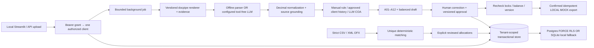

# Architecture and safety boundaries

Sources and rendered images are scoped by tenant. The API checks server-held grants before any source/document/job/bank/review/export access. Model payloads include only one tenant and explicitly reject foreign tenant markers. File paths are never supplied by the API reader: source access resolves a stored authorized document and verifies its tenant storage root.

All financial mutations are serialized: SQLite `BEGIN IMMEDIATE`, Postgres transaction-scoped advisory lock per client. Settlement allocation checks and writes occur in the same transaction. Corrections revoke the source approval, invalidate related settlements, preserve old exports and audit the before/after version; they cannot recall a prior external ledger posting because no external posting exists. Learned mappings are computed from current approved revisions, not an irreversibly cached vendor overwrite.

Database audit rows are append-only through the application workflow, but the database application role technically has UPDATE/DELETE rights on records. This is **not tamper-proof audit storage**. The API is a local prototype with public demo tokens, not a production identity provider. Financial configuration edits are human-authorized and invalidate approvals. No unattended approvals or posting path exists.
